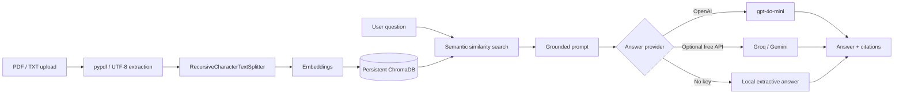

# DocuMind — Local RAG Document Search & Q&A

[](https://www.python.org/)
[](https://flask.palletsprojects.com/)
[](https://www.langchain.com/)
[](https://www.trychroma.com/)

Upload local PDF/TXT files, search their contents semantically, and ask grounded questions with page-level source citations. The application is designed to be private by default: documents and the Chroma vector index stay on your machine.

## Features

- Multi-file PDF and TXT ingestion with page-aware metadata.
- Recursive character chunking with overlap for better retrieval boundaries.
- Persistent local ChromaDB vector store.
- OpenAI `text-embedding-3-small` + `gpt-4o-mini` support.
- Automatic HuggingFace `all-MiniLM-L6-v2` embedding fallback.
- Optional Groq (`openai/gpt-oss-120b`) or Gemini free-tier generation, plus deterministic local extractive fallback.
- Citation accordion with source filename, exact page, retrieved chunk, and similarity score.
- Citation scores are relative relevance scores within the retrieved result set, not calibrated probabilities.
- Responsive dark SaaS UI using TailwindCSS CDN and vanilla JavaScript.
- API keys are accepted per request and are not stored in the repository or database.

## Architecture



## Quick start

### Windows PowerShell

```powershell
 # Use the existing Python 3.12 environment.
python -m venv venv
.\venv\Scripts\Activate.ps1
.\install_windows.ps1
Copy-Item .env.example .env
python app.py
```

Open <http://127.0.0.1:5000>. If PowerShell blocks activation, run `Set-ExecutionPolicy -Scope Process Bypass` once in that terminal.

`install_windows.ps1` avoids the unavailable `chroma-hnswlib==0.7.6` source build
by installing the available Windows binary `0.7.5`, then installs the compatible
Chroma Python packages without letting pip replace that binary. Do not launch
`app.py` until the script prints `Dependencies ready.`

For Linux/macOS, use `pip install -r requirements.txt` directly.

The first keyless run downloads the SentenceTransformers model (roughly 90 MB) and stores it in the normal HuggingFace cache. For hosted answers, add a key in `.env` or paste one into the sidebar. A Groq or Gemini free-tier key is enough to get conversational answers without OpenAI credits.

## Deploy on Render

The repository includes [`render.yaml`](./render.yaml) for a one-click Render deployment.

1. Create a new Web Service at <https://render.com> and select this GitHub repository.
2. Render will read the build and start commands from `render.yaml`.
3. Add a new, unexposed provider key in Render's Environment settings (`GROQ_API_KEY` or `GEMINI_API_KEY`).
4. Deploy and open the generated `onrender.com` URL.

The free plan has ephemeral storage: uploaded documents and `chroma_db/` can disappear
when the service restarts or redeploys. Add a persistent disk or external object/vector
storage before using this for production data. Never commit `.env` or provider keys.

## REST API

- `POST /upload`: multipart form field `files`; accepts `.pdf` and `.txt`.
- `POST /ask`: JSON `{ "question": "...", "history": [] }`.
- `POST /clear`: removes the local index and uploaded files.
- `DELETE /documents/<filename>`: removes one uploaded file and only its indexed chunks.
- `GET /documents`: returns indexed upload metadata.

Optional per-request headers: `X-OpenAI-Key`, `X-Groq-Key`, `X-Gemini-Key`, and `X-LLM-Model`.

## Production notes

- Put Flask behind a production WSGI server such as Waitress or Gunicorn and a reverse proxy.
- Set a strong `FLASK_SECRET_KEY`, restrict upload size, and add authentication before exposing this to a network.
- Keep `chroma_db/`, `uploads/`, and `.env` out of version control; they are already ignored.
- For larger corpora, add authentication, background ingestion jobs, file quotas, and a managed vector store.

## Project layout

```text
app.py                 Flask routes and application wiring
rag_engine.py          Ingestion, embeddings, retrieval, prompting, fallbacks
templates/index.html   Responsive chat UI
requirements.txt       Pinned runtime dependencies
.env.example           Configuration template
```
